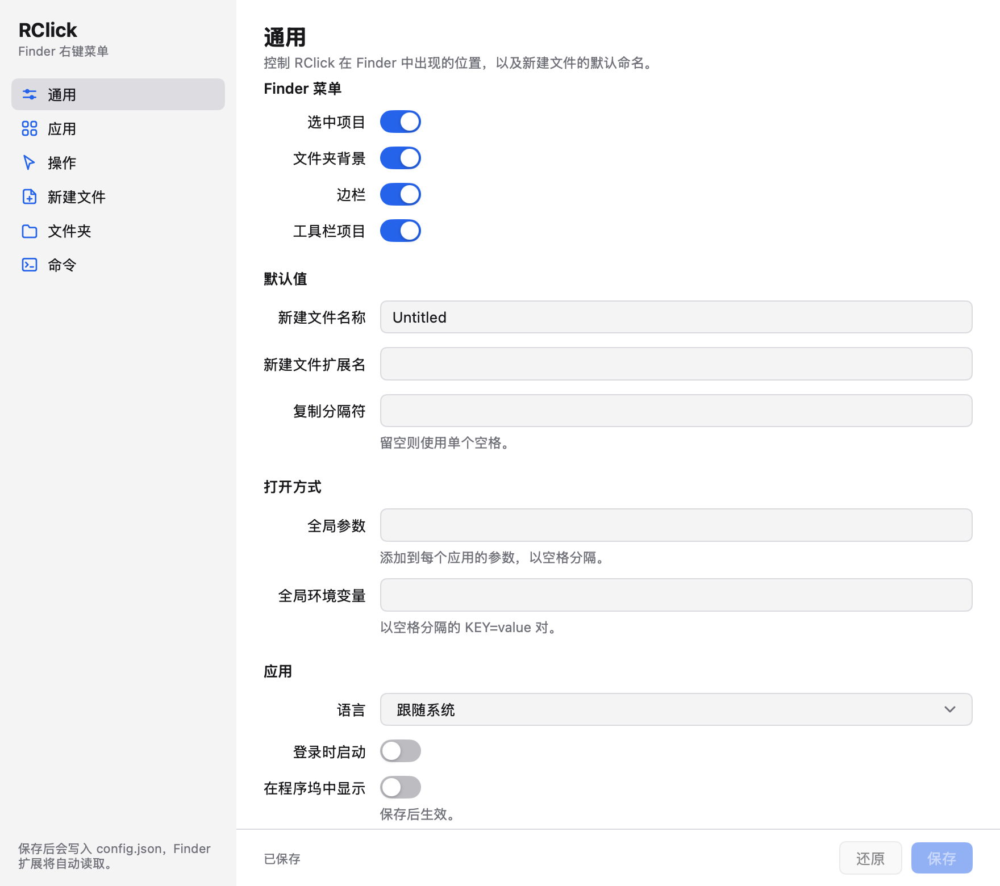
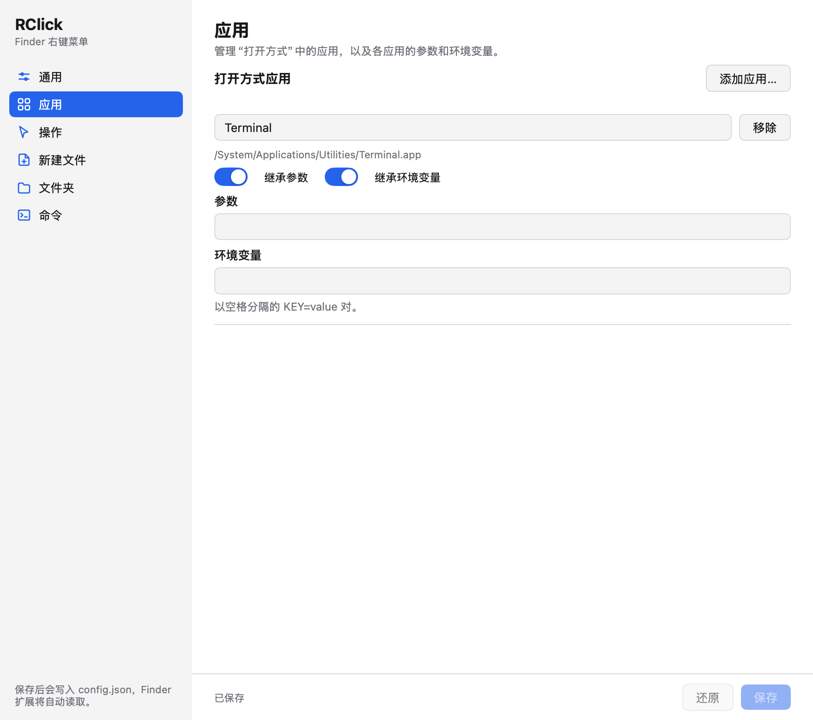
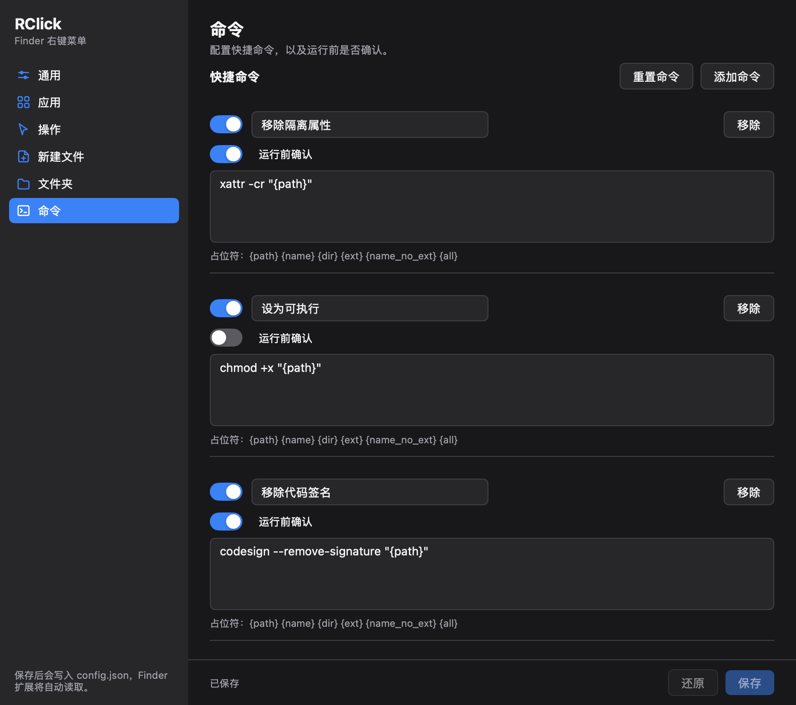
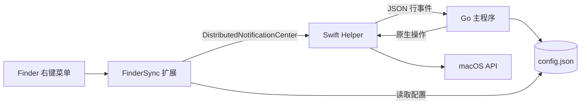

<p align="center">
  
</p>

<h1 align="center">RClick</h1>

<p align="center">macOS Finder 右键菜单增强工具<br>把文件操作、新建文件、打开方式和快捷命令放进右键菜单。</p>

<p align="center">
  
</p>
<p align="center"><sub>通用设置：Finder 菜单开关、默认值与打开方式</sub></p>

## 功能

| 分区 | 能力 |
| --- | --- |
| 通用 | 控制菜单显示位置、新建文件默认值、Open With 全局参数与语言 |
| 应用 | 配置“用其他应用打开”的应用列表、参数与环境变量 |
| 操作 | 启用或停用复制路径、直接删除、隐藏、取消隐藏、隔空投送 |
| 新建文件 | 管理右键菜单中的文件类型、显示名称与扩展名 |
| 文件夹 | 配置常用文件夹与显示 RClick 菜单的监视文件夹 |
| 命令 | 配置针对选中文件执行的快捷命令与危险命令确认 |

- Go 主程序负责托盘、设置窗口、配置和业务路由。
- FinderSync 扩展负责构建右键菜单，并读取共享配置。
- Swift helper 负责 mygo 未暴露的 macOS API：隔空投送、废纸篓、隐藏属性、指定应用打开和确认弹窗。
- 设置页支持中文、英文与跟随系统，并提供浅色/深色外观。

### 应用与命令

<p align="center">
  
</p>
<p align="center"><sub>应用：管理打开方式、参数和环境变量</sub></p>

<p align="center">
  
</p>
<p align="center"><sub>命令：快捷命令模板与运行前确认，深色模式</sub></p>

## 架构



Go 主程序与 Swift 扩展共享 `config.json`，JSON 键名是跨语言契约。修改字段时需同步检查 Go 与 Swift 两侧。

## 环境要求

- macOS 15 或更高版本
- Go 1.27.3（mygo v0.8.1 要求）
- Xcode 命令行工具：`xcrun`、`swiftc`、`codesign`、`pluginkit`

`make` 优先使用 `PATH` 中的 `go`，找不到时回退到 `~/Library/Go/1.27.3/bin/go`。可通过 `GO=/path/to/go` 覆盖。

## 快速开始

```bash
make build      # go build ./...
make test       # go test ./...
make vet        # go vet ./...
make dev        # 构建 helper 并启动 mygo 开发版
```

开发调试可设置：

```bash
RCLICK_OPEN_SETTINGS=1 make dev
```

### 打包与安装

```bash
REGISTER=0 make package   # 生成本地 app 与 DMG，不注册系统扩展
make install              # 安装到 ~/Applications 并注册 Finder 扩展
```

默认产物：

```text
build/darwin-arm64/RClick.app
build/RClick-3.0.0-arm64.dmg
```

`make package` 默认会向 Launch Services / pluginkit 注册扩展；只想要本地包时使用 `REGISTER=0`。`make install` 会把应用复制到 `~/Applications` 并启用扩展。

### 启用 Finder 扩展

1. 打开一次 `~/Applications/RClick.app`（无 Dock 图标，请使用菜单栏图标）。
2. 系统设置 → 通用 → 登录项与扩展 → 扩展 → 访达，启用 **RClickFinderSync**。
3. 若菜单未出现，重启 Finder：

```bash
killall Finder
pluginkit -m -v -i cn.wflixu.RClick.FinderSyncExt   # 应显示 +
```

Finder 只会加载安装在 `/Applications` 或 `~/Applications` 下应用中的扩展；仅在 `build/` 下构建不会生效。本项目使用 ad-hoc 签名，面向个人自用，不包含公证、自动更新或 App Store 打包。

## 配置

默认配置位于：

```text
~/Library/Application Support/RClick/config.json
```

配置使用 `0600` 权限和原子写入。顶层键：`schemaVersion`、`revision`、`updatedAt`、`apps`、`actions`、`newFiles`、`commonDirs`、`permissionDirs`、`quickCommands`、`menu`、`defaults`、`ui`。

保存后主程序会递增 `revision`、更新时间，并发送 `running` 通知让 Finder 扩展重新读取配置。

| 环境变量 | 用途 |
| --- | --- |
| `RCLICK_CONFIG` | 覆盖 `config.json` 路径，便于隔离测试 |
| `RCLICK_HELPER` | 指定 `RClickHelper` 的绝对路径 |
| `RCLICK_OPEN_SETTINGS` | 设为 `1` 时启动即打开设置窗口 |

## 操作路由

| Finder 动作 | Go 侧处理 |
| --- | --- |
| `open` | helper `openWith`，合并全局/应用参数与环境变量 |
| `actioning` + `copy-path` | 写入剪贴板 |
| `actioning` + `delete-direct` | helper `trash`，跳过受保护路径 |
| `actioning` + `hide` / `unhide` | helper `hidden` |
| `actioning` + `airdrop` | helper `airdrop` |
| `Create File` | 生成不重名文件，可选用模板 |
| `common-dirs` | helper `open` |
| `quick-command` | `/bin/zsh -lc`，危险命令先确认 |
| `heartbeat` | 回复 `running`，携带监听的文件夹 |

`copy-path` 只复制首个选中路径；容器触发的直接删除会被拒绝，隔空投送会忽略目录。

## 快捷命令与安全

快捷命令在本机 `/bin/zsh -lc` 中执行。标记为危险的命令在运行前会请求确认，确认后默认 15 分钟内不重复询问；确认机制不是沙盒，模板内容仍由用户自行审阅。

命令模板支持：

```text
{path} {name} {dir} {ext} {name_no_ext} {all}
```

## 日志与调试

```text
~/Library/Logs/RClick/rclick.log
```

```bash
log stream --predicate 'subsystem == "cn.wflixu.RClick.FinderSyncExt"' --level debug
pluginkit -m -v -i cn.wflixu.RClick.FinderSyncExt
defaults read cn.wflixu.RClick
```

## 测试与文档

```bash
make test
```

设置页使用 mygo 的无窗口 `ui.Tester` 覆盖分区切换、保存按钮状态与最小尺寸；配置、国际化和文件服务测试位于 `internal/` 各包。

- [文档索引](docs/README.md)
- [架构全景图](docs/架构全景图.md)
- [0001 设置界面现代化改版](docs/需求/0001-设置界面现代化改版-需求清单.md)
- [AI 协作约定](AGENTS.md)

## 已知限制

- 只支持 macOS 15 及以上，当前构建目标为 arm64。
- 使用 ad-hoc 签名，不包含公证、自动更新器或 App Store 打包。
- Finder 扩展必须安装到 `/Applications` 或 `~/Applications` 并手动启用。
- 依赖 helper 的原生操作在 helper 不可用时无法完成。
- 不包含沙盒主程序、安全书签或跨平台版本。
