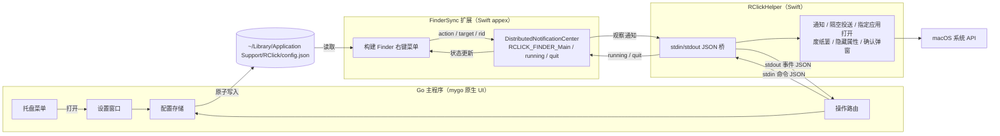

# rclick-go

RClick 的 Go 主程序实现，保留原有 Swift FinderSync 扩展。工程完全自包含，可直接复制到其他目录独立使用。

模块路径：`github.com/bambuo/rclick-go`。

## 项目文档

- [文档索引](docs/README.md)：架构、功能清单、术语、限制与流程。
- [架构全景图](docs/架构全景图.md)：系统边界与运行时链路。
- [代理协作约定](AGENTS.md)：仓库地图、命令与变更约束。

## 架构



- Go 进程负责配置、菜单栏图标和设置窗口。
- Swift 辅助进程（helper）负责 mygo 未暴露的 macOS API：`DistributedNotificationCenter`、隔空投送（AirDrop）、带参数/环境变量的指定应用打开（open-with）、废纸篓、隐藏属性。
- FinderSync 扩展职责不变：读取 `config.json`，发送 `RCLICK_FINDER_Main` 通知，并响应 `running` / `quit`。

## 目录结构

```
cmd/rclick/            程序入口与日志
internal/config/       配置结构、默认值、校验、原子写入
internal/i18n/         中英文界面文案
internal/ipc/          IPC 消息类型与 Swift helper 桥接
internal/services/     文件操作、应用启动、快捷命令、模板解析
internal/app/          托盘、设置窗口、操作路由、内嵌图标
native/helper/         Swift helper（无状态栏图标版本）
native/finder/         FinderSync 扩展源码、Info.plist、entitlements、
                       图标、en/zh-Hans 本地化字符串
resources/             应用图标、模板托盘图标、原始菜单栏 SVG
scripts/package-local.sh
```

## 环境要求

- macOS 15 或更高版本
- Go 1.27.3（mygo v0.8.1 要求的版本）
- Xcode 命令行工具（`xcrun`、`swiftc`、`codesign`、`pluginkit`）

`make` 会优先使用 `PATH` 中的 `go`，找不到时回退到
`~/Library/Go/1.27.3/bin/go`。可通过 `GO=/path/to/go` 覆盖。

## 构建与测试

```bash
make build      # go build ./...
make test       # go test ./...
make helper     # 编译 native/helper/bin/RClickHelper
make finder     # 编译 native/finder/bin/RClickFinderSync
make package    # mygo 构建 + helper + appex + ad-hoc 签名
make install    # 打包、安装到 ~/Applications、注册并启用扩展
```

`make package` 支持以下变量：

```bash
SKIP_DMG=1 make package   # 跳过 DMG
REGISTER=0 make package   # 不修改 Launch Services / pluginkit
INSTALL_DIR=/Applications make package
VERSION=3.0.1 make package
```

应用默认输出到 `build/darwin-arm64/RClick.app`。

### 沙盒与安装

macOS 会拒绝未沙盒化的 Finder 扩展，`pkd` 日志中的报错为
`plug-ins must be sandboxed`。因此 appex 使用
[FinderSyncExt.entitlements](native/finder/FinderSyncExt.entitlements) 签名，
其中包含 App Sandbox，以及对 `~/Library/Application Support/RClick/`
的只读例外。

沙盒中的 appex 会把容器目录当作主目录，因此 `SharedConfigStore` 通过
`PathSecurityChecker.getRealHomeDir()` 还原真实家目录，再读取
`config.json`。

Finder 只会加载安装在 `/Applications` 或 `~/Applications` 下应用中的扩展；
仅在 `build/` 下构建不会生效。`make install` 会把应用复制到
`~/Applications`，注册并启用 appex。

### 启用 Finder 扩展

1. 执行 `make install`。
2. 打开一次 `~/Applications/RClick.app`（无 Dock 图标，请使用菜单栏图标）。3. 系统设置 → 通用 → 登录项与扩展 → 扩展 → 访达 → 启用
   **RClickFinderSync**（也可依赖 `pluginkit -e use`）。
4. 如果菜单未出现，重启 Finder：

```bash
killall Finder
pluginkit -m -v -i cn.wflixu.RClick.FinderSyncExt   # 应显示 +
```

本构建使用 ad-hoc 签名，自用无需 Mac App Store、描述文件或公证。

## 开发调试

```bash
make dev
```

`mygo dev` 会构建并启动开发版；helper 会先被编译，并通过
`native/helper/bin/RClickHelper`（或 `RCLICK_HELPER`）找到。

可用环境变量：

| 变量 | 含义 |
| --- | --- |
| `RCLICK_HELPER` | `RClickHelper` 的绝对路径 |
| `RCLICK_CONFIG` | 覆盖 `config.json` 路径（便于测试） |
| `RCLICK_OPEN_SETTINGS` | 设为 `1` 时启动即打开设置窗口 |

日志位置：`~/Library/Logs/RClick/rclick.log`，helper 的 stderr 也会写入该文件。

```bash
log stream --predicate 'subsystem == "cn.wflixu.RClick.FinderSyncExt"' --level debug
pluginkit -m -v -i cn.wflixu.RClick.FinderSyncExt
defaults read cn.wflixu.RClick
```

## 配置文件

文件位于 `~/Library/Application Support/RClick/config.json`，权限 `0600`，
采用原子写入。Finder 扩展通过 `SharedConfigStore.swift` 读取同一文件；
JSON 键名属于跨语言契约，不应随意修改。

顶层键：`schemaVersion`、`revision`、`updatedAt`、`apps`、`actions`、
`newFiles`、`commonDirs`、`permissionDirs`、`quickCommands`、`menu`、
`defaults`、`ui`。

保存时会递增 `revision`、更新 `updatedAt`，并发送 `running` 通知，
让扩展重新加载配置。Swift 解码器会忽略未知键。

### 语言

Go 界面跟随 macOS 首选语言，目前支持英文和简体中文。设置窗口的
“通用 → 语言”也可切换，保存为 `ui.language`，取值为 `system`、`en`
或 `zh-Hans`。

Finder 扩展通过 `native/finder/en.lproj` 与
`native/finder/zh-Hans.lproj` 本地化，打包脚本会把两者复制到 appex 的
`Resources` 目录。

## 操作路由

| Finder 动作 | Go 侧处理 |
| --- | --- |
| `open` | helper `openWith`，合并全局/应用参数与环境变量 |
| `actioning` + `copy-path` | 写入剪贴板 |
| `actioning` + `delete-direct` | helper `trash`，跳过受保护路径 |
| `actioning` + `hide` / `unhide` | helper `hidden` |
| `actioning` + `airdrop` | helper `airdrop` |
| `Create File` | 生成不重名文件，可选用模板 |
| `common-dirs` | helper `open` |
| `quick-command` | `/bin/zsh -lc`，危险命令先确认（15 分钟内免重复确认） |
| `heartbeat` | 回复 `running`，携带监听的文件夹 |

## 实机验证结果

在 macOS 26 上，将 App 安装到 `~/Applications` 并启用扩展后，真实右键
文件可看到中文菜单：

```
用 Terminal 打开
新建文件 → JSON / TXT / Markdown / Word 文档 / 演示文稿 / 电子表格
移除隔离属性 / 设为可执行 / 移除代码签名
显示文件信息 / 压缩文件
复制路径 / 直接删除 / 隐藏 / 取消隐藏 / 隔空投送
```

已通过真实菜单验证以下动作：

- **复制路径**：选中文件路径写入剪贴板。
- **新建文件 → TXT**：在目标目录创建 `Untitled.txt`。
- **显示文件信息**：快捷命令 `file` 执行成功，退出码 0。
- **直接删除**：文件移入废纸篓。

菜单栏图标为带透明通道的黑色模板 PNG
（`internal/app/assets/tray.png`）；若图标为不透明白底，会显示成空白方块。

## 已知范围

- 不包含 Sparkle 类更新器、App Store 打包、沙盒主程序或安全书签；仅面向
  ad-hoc 签名的个人使用场景。
- 扩展中的 App/新建文件图标来自 appex 的 `Resources`
  （`icon-file-*.png`、`toolbar.png`）；其他图标使用 SF Symbols。
- 未包含旧版 `MenuItemClickable.swift`：它引用了已移除的
  `UserDefaults` 辅助方法，且不属于当前扩展构建。
- `ui`、`defaults` 与 `menu.copySeparator` 字段用于兼容；
  `copy-path` 与旧版一致，只复制第一个选中路径。
