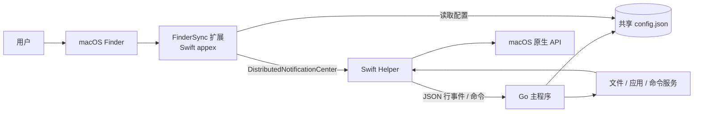
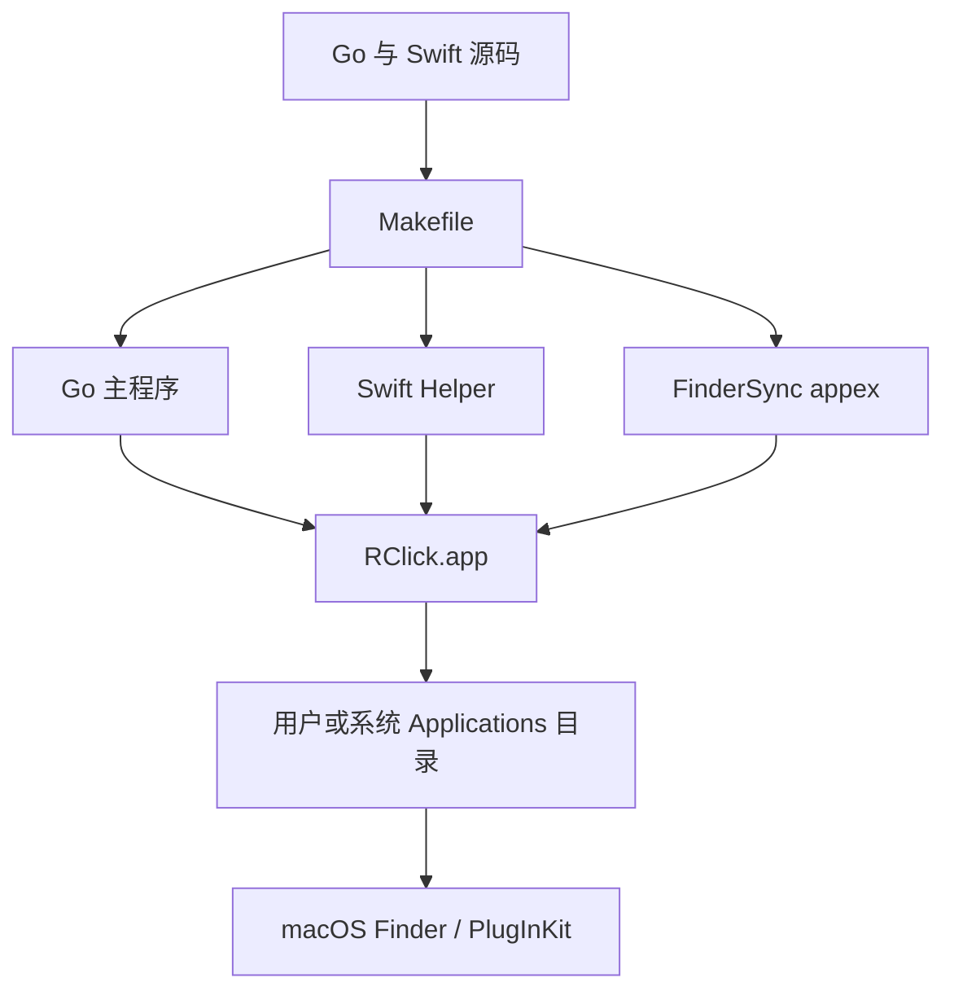
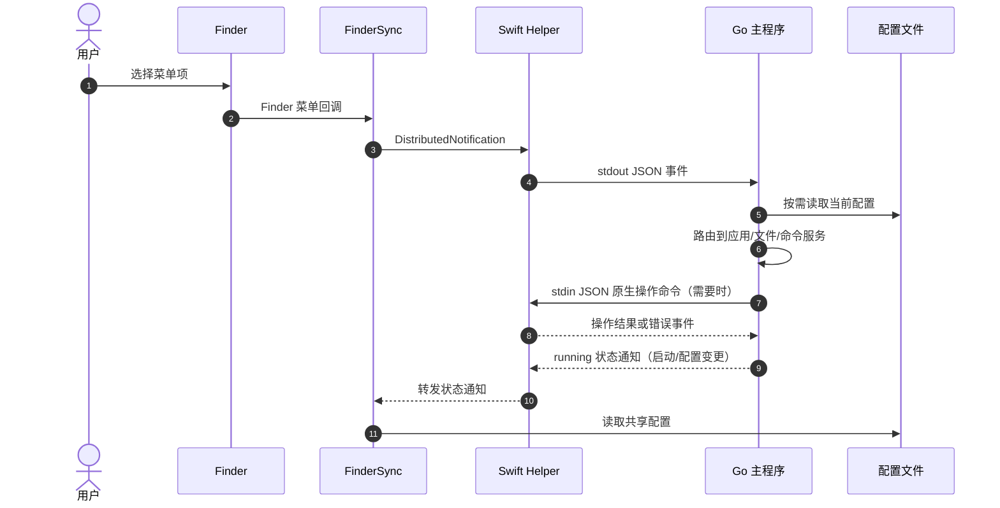

# 架构全景图

> 项目：RClick (`github.com/bambuo/rclick-go`)
> 状态：基于当前工作区源码整理；Git commit 未提供。
> 范围：系统边界、打包拓扑和跨进程运行时链路。

## 系统上下文

FinderSync、helper 与 macOS API 是平台边界；本仓库的 Go 程序不提供 HTTP/gRPC 服务。配置文件由 Go 写入、FinderSync 读取，JSON 键是跨语言契约。

## 部署与构建拓扑

构建脚本目标为 arm64 macOS 15；默认 app 输出目录为 `build/darwin-arm64/RClick.app`。安装、签名和扩展注册属于本机操作，本次未运行。见 [Makefile](../Makefile#L19-L52) 与 [打包脚本](../scripts/package-local.sh#L29-L66)。

## 运行时链路

当前链路由 [`internal/app/app.go`](../internal/app/app.go#L42-L145)、[`internal/app/router.go`](../internal/app/router.go#L11-L96)、[`native/finder/FinderSyncExt.swift`](../native/finder/FinderSyncExt.swift#L27-L68) 和 [`native/helper/RClickHelper.swift`](../native/helper/RClickHelper.swift#L54-L101) 支持。通知和 helper IPC 是不同通道；具体调用视功能而定。

组件职责、启动顺序与配置字段见[项目架构与模块](功能/01-项目架构与模块.md)。
