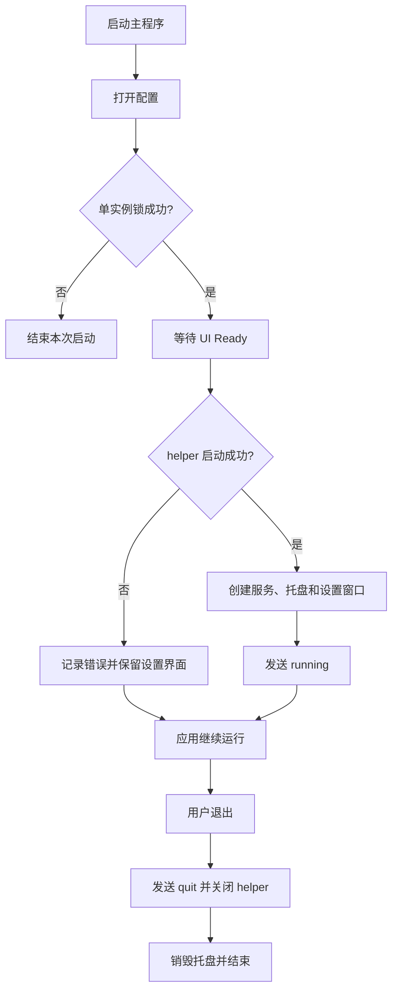
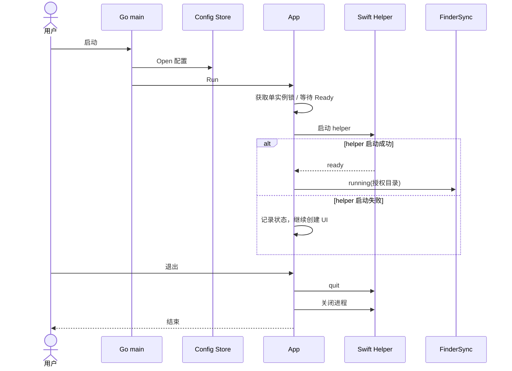
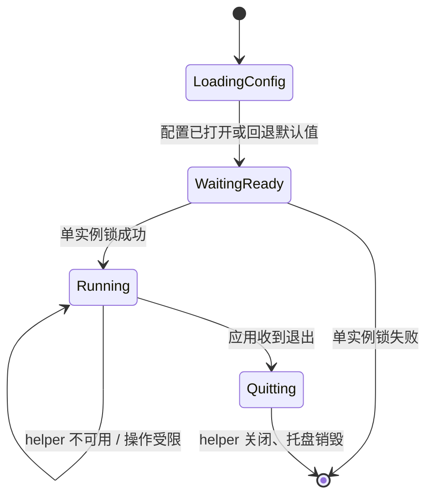

# 01 应用启动与退出（v1）

> 文档编号：01
> 文档版本：v1
> 项目：RClick
> 状态：主路径已实现；helper 失败时部分功能不可用
> 证据基线：当前工作区源码；无 Git commit 信息。

## 1. 流程目标

启动 Go 桌面应用并连接 FinderSync 扩展；退出时通知并关闭 helper。

## 2. 参与角色与前置条件

| 角色 | 职责 |
| --- | --- |
| macOS 用户 | 启动或退出应用 |
| Go 主程序 | 读取配置、初始化托盘/UI 与业务服务 |
| Swift helper | 转发 Finder 消息和执行原生操作 |
| FinderSync 扩展 | 接收状态通知并维护菜单状态 |

## 3. 主流程图

## 4. 时序图

## 5. 状态机

该图表示进程生命周期，不是持久化业务状态。

## 6. 关键异常与分支

| 场景 | 当前处理 |
| --- | --- |
| 配置读取失败 | 入口记录错误；Store 回退默认配置后继续初始化 |
| 单实例锁失败 | 当前启动返回，不创建第二个实例 |
| helper 启动失败 | 记录状态；UI 仍启动，helper 依赖功能不可用 |
| 退出时 helper 关闭 | 发送 quit 后关闭 helper；发送错误只忽略 |

## 7. 证据索引

- [入口与日志](../../cmd/rclick/main.go#L13-L39)
- [应用启动、ready、shutdown](../../internal/app/app.go#L42-L115)
- [running 与 heartbeat](../../internal/app/app.go#L117-L145)
- [配置打开行为](../../internal/config/store.go#L21-L46)

## 8. 实现风险与待确认

- FinderSync 的实际加载状态依赖本机安装与 PlugInKit；静态源码不能证明某台机器已启用。
- 配置损坏时继续使用默认配置虽能启动，但修复配置需用户处理原文件。
