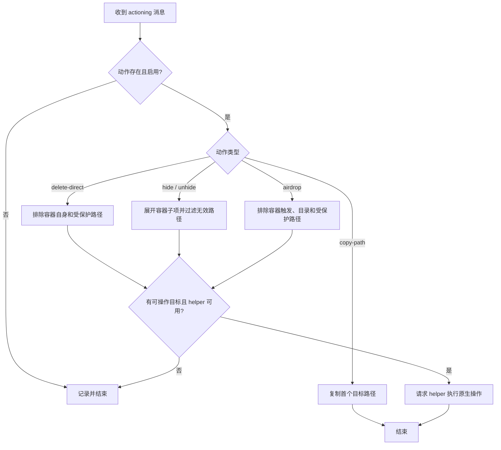
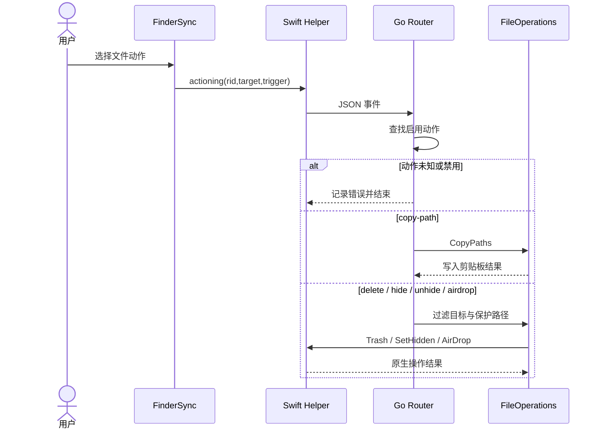
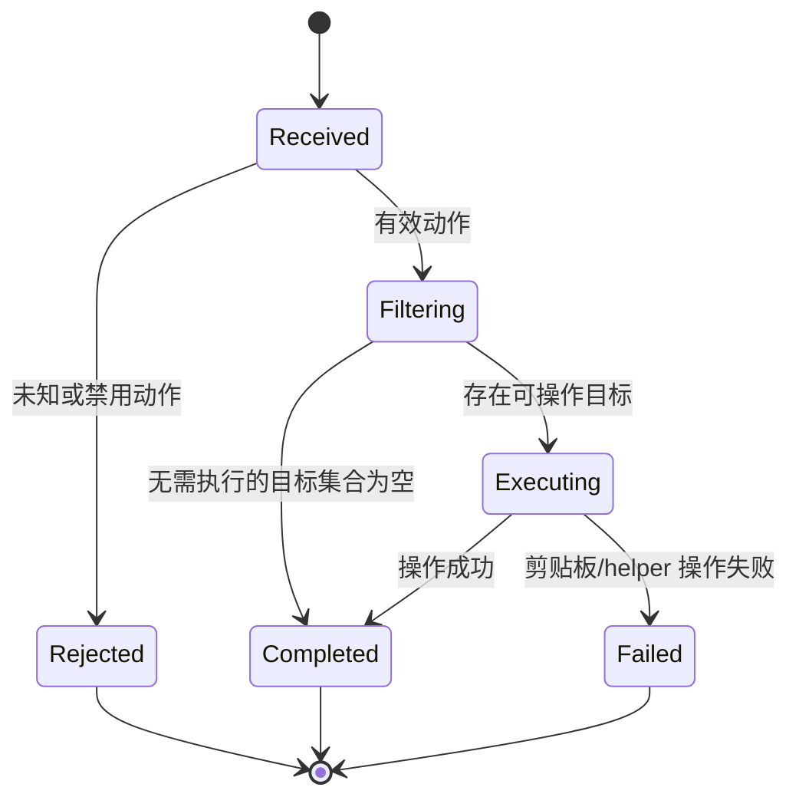

# 02 Finder文件动作（v1）

> 文档编号：02
> 文档版本：v1
> 项目：RClick
> 状态：主路径已实现；原生操作依赖 helper
> 证据基线：当前工作区源码；无 Git commit 信息。

## 1. 流程目标

接收 Finder 的 `actioning` 消息，按已启用的动作 ID 处理路径目标。

## 2. 参与角色与前置条件

| 角色 | 职责 |
| --- | --- |
| 用户 / Finder | 选择文件并触发菜单 |
| FinderSync / helper | 发送动作 ID、目标和触发上下文 |
| Go 路由 | 校验动作是否存在且启用，再分发 |
| 文件服务 | 复制路径、跳过受保护项或请求 helper 执行原生操作 |

## 3. 主流程图

## 4. 时序图

## 5. 状态机

这是单次调用的控制状态，不写入配置或持久化。

## 6. 关键异常与分支

| 场景 | 当前处理 |
| --- | --- |
| 动作不存在或禁用 | 记录日志并结束 |
| 直接删除容器本身 | 拒绝删除 |
| 受保护路径 | 删除/AirDrop 跳过；隐藏过滤保护目录 |
| AirDrop 目标是目录 | 跳过目录 |
| helper 不可用 | 需要原生能力的操作返回错误 |
| 空目标 | 对应操作不执行；复制路径空列表返回成功 |

## 7. 证据索引

- [Go 动作路由](../../internal/app/router.go#L60-L96)
- [路径复制、删除、隐藏、AirDrop](../../internal/services/files.go#L34-L133)
- [保护路径规则](../../internal/services/protected.go#L5-L39)
- [消息字段](../../internal/ipc/payload.go#L10-L30)

## 8. 实现风险与待确认

- Finder 的目标 URI 如何映射为本地路径由解码代码和系统回调共同决定；扩展行为需在 macOS 实机验证。
- “直接删除”实际走 helper 的废纸篓能力，不应理解为不可恢复的直接 unlink。
