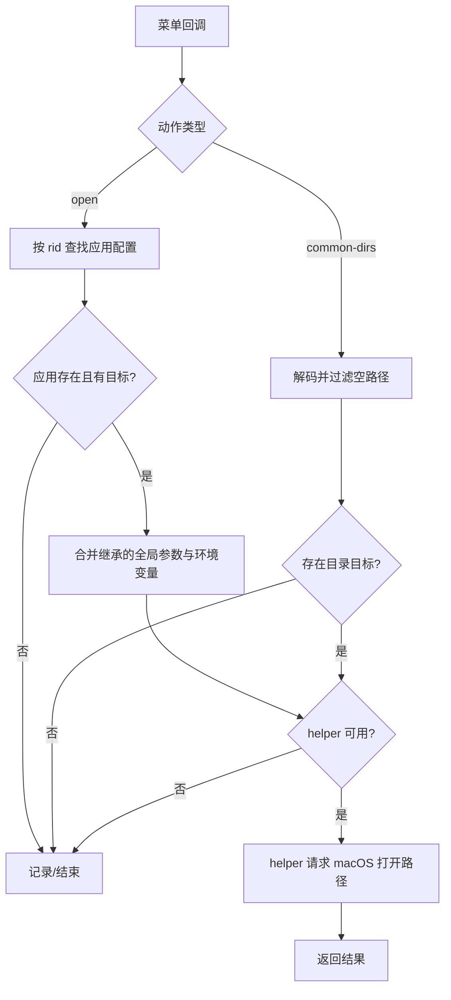
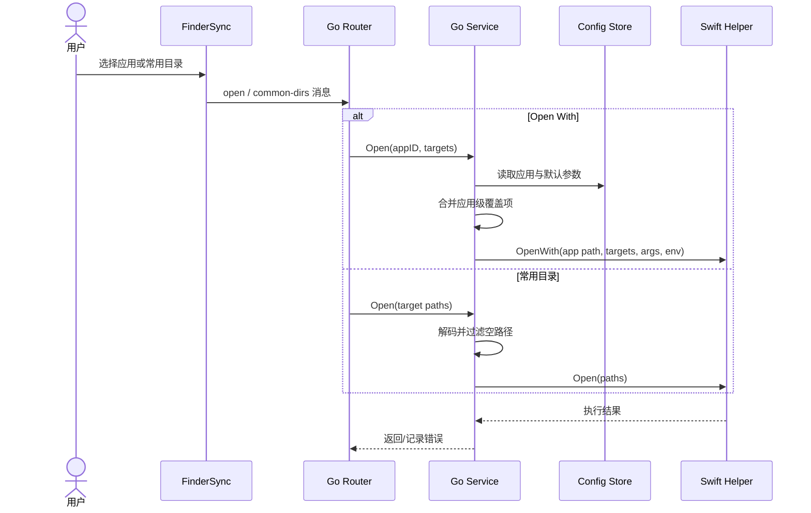

# 03 打开方式与常用目录（v1）

> 文档编号：03
> 文档版本：v1
> 项目：RClick
> 状态：主路径已实现；原生打开依赖 helper
> 证据基线：当前工作区源码；无 Git commit 信息。

## 1. 流程目标

Finder 菜单触发后，按配置打开目标文件或目录；Open With 合并继承的参数和环境变量。

## 2. 参与角色与前置条件

| 角色 | 职责 |
| --- | --- |
| FinderSync | 根据配置生成应用/目录菜单项 |
| Go 路由 | 识别 `open` 或 `common-dirs` 消息 |
| AppLauncher / FileOperations | 查配置并构造打开请求 |
| Swift helper | 调用 macOS 打开能力 |

## 3. 主流程图

## 4. 时序图

## 5. 状态机

该状态机描述调用过程，不代表持久化状态。

## 6. 关键异常与分支

| 场景 | 当前处理 |
| --- | --- |
| 应用 ID 不存在 | 返回错误，由消息处理层记录 |
| Open With 目标为空 | 不调用 helper 并返回 |
| 常用目录路径为空 | 过滤后无目标则返回 |
| helper 不可用 | 返回 helper unavailable |
| 参数/环境合并 | 应用配置覆盖同名全局环境变量；参数先全局后应用级追加 |

## 7. 证据索引

- [动作路由](../../internal/app/router.go#L21-L43)
- [Open With 参数合并](../../internal/services/apps.go#L16-L52)
- [常用路径处理](../../internal/services/files.go#L135-L149)

## 8. 实现风险与待确认

- `URL` 字段在 Open With 中表示本机应用路径，不是网络 URL。
- 常用目录配置的编辑与 Finder 菜单渲染细节依赖扩展端代码；实际系统打开行为需在 macOS 验证。
