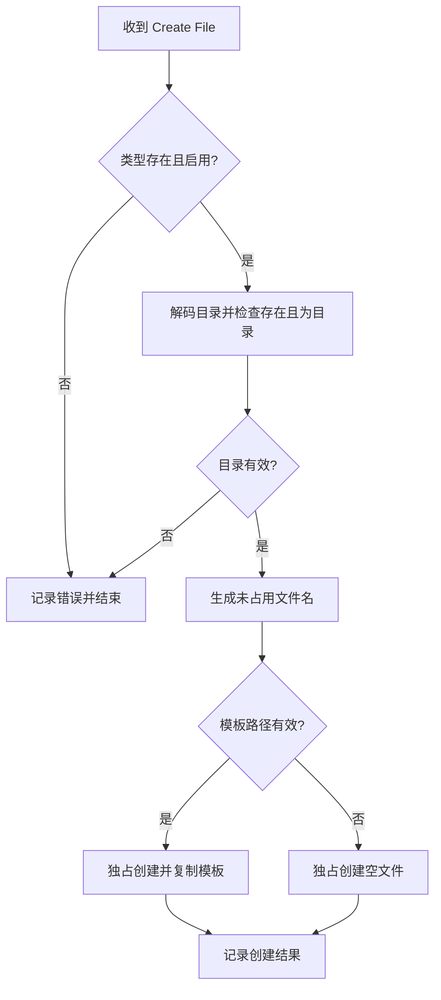
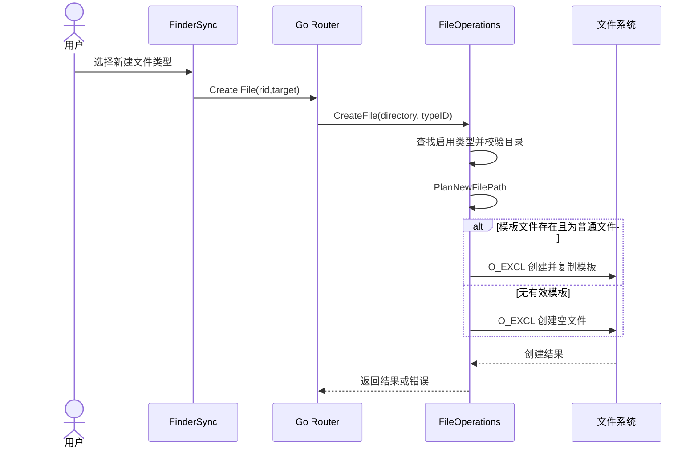
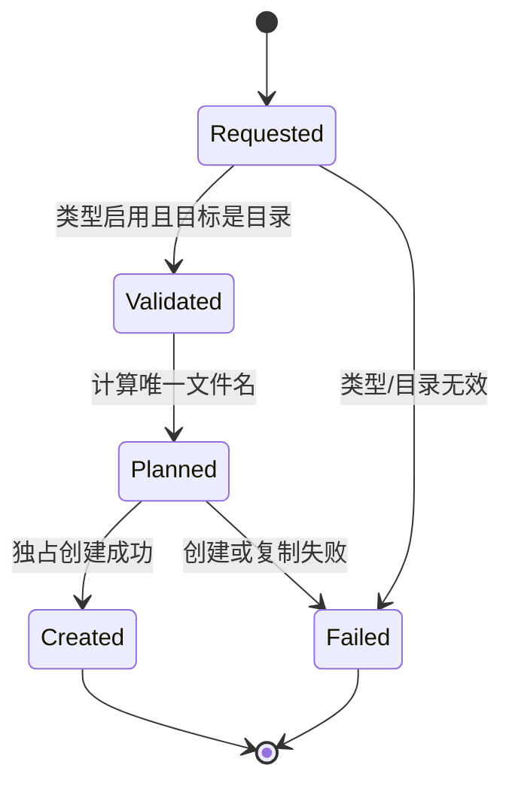

# 04 新建文件（v1）

> 文档编号：04
> 文档版本：v1
> 项目：RClick
> 状态：主路径已实现
> 证据基线：当前工作区源码；无 Git commit 信息。

## 1. 流程目标

在 Finder 目标目录中按启用的文件类型创建一个不重名文件，可选从模板复制内容。

## 2. 参与角色与前置条件

| 角色 | 职责 |
| --- | --- |
| FinderSync | 提供文件类型菜单并发送目标目录和类型 ID |
| Go Router | 将消息转发给文件服务 |
| FileOperations | 校验配置/目录，规划名称并创建文件 |
| 文件系统 | 独占创建目标或模板副本 |

## 3. 主流程图

## 4. 时序图

## 5. 状态机

## 6. 关键异常与分支

| 场景 | 当前处理 |
| --- | --- |
| 类型不存在或禁用 | 返回错误 |
| 目录不存在或不是目录 | 返回错误 |
| 模板配置无效/路径不存在/是目录 | 回退为空文件创建 |
| 文件名已存在 | 规划器尝试后续编号；最终创建使用独占标志避免覆盖 |
| 创建/复制失败 | 返回错误；复制中途失败会移除部分目标文件 |

## 7. 证据索引

- [新建文件路由](../../internal/app/router.go#L30-L36)
- [类型与目录校验、创建](../../internal/services/files.go#L151-L193)
- [文件名规划](../../internal/services/planner.go#L11-L39)
- [默认文件类型](../../internal/config/defaults.go#L59-L68)

## 8. 实现风险与待确认

- 默认文件扩展名集合由配置定义，用户可编辑配置；不能假设每台机器的菜单完全相同。
- 创建完成后是否自动打开文件未在本流程所列 Go 创建路径中确认。
