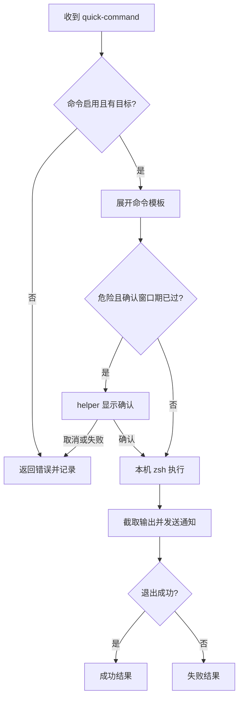
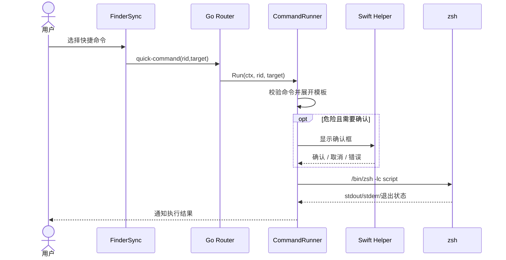
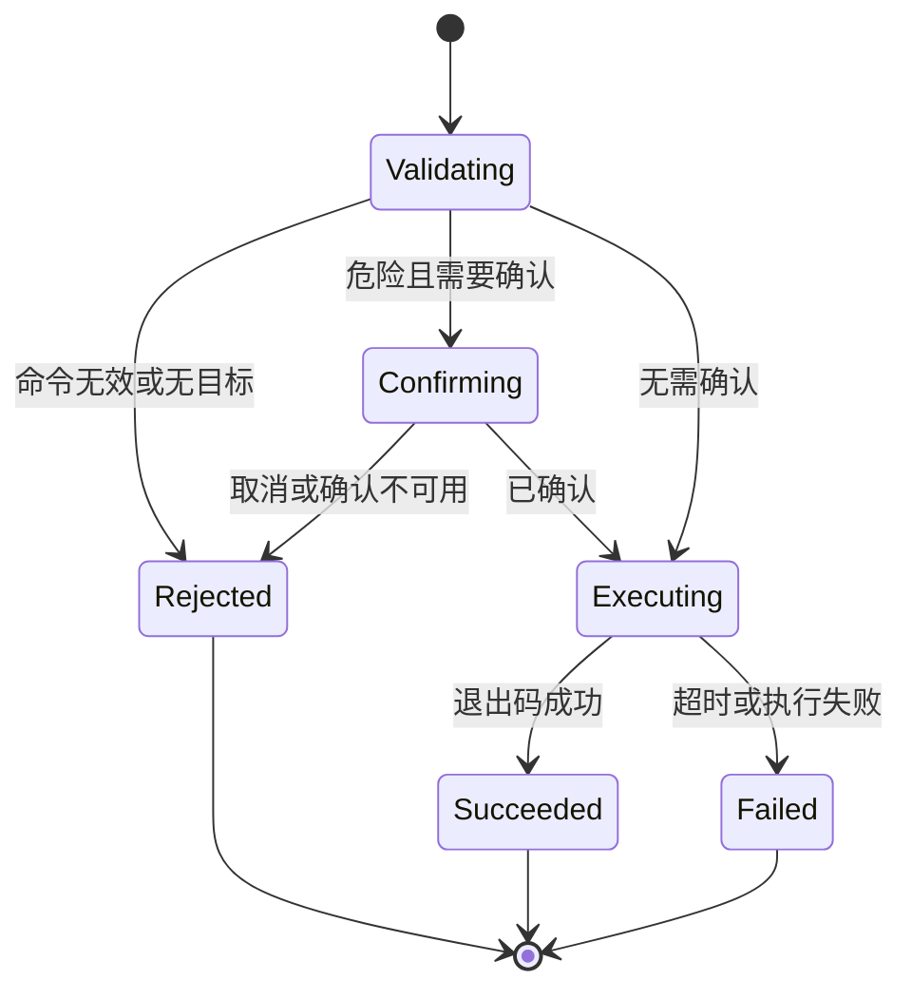

# 05 快捷命令（v1）

> 文档编号：05
> 文档版本：v1
> 项目：RClick
> 状态：主路径已实现；命令在本机 shell 执行
> 证据基线：当前工作区源码；无 Git commit 信息。

## 1. 流程目标

将 Finder 选中目标代入已启用命令模板，按需确认后在本机执行并通知结果。

## 2. 参与角色与前置条件

| 角色 | 职责 |
| --- | --- |
| 用户 / FinderSync | 触发快捷命令并提供目标路径 |
| Go Router | 建立最长 10 分钟的命令 context 并调用 runner |
| CommandRunner | 查找命令、展开模板、确认危险命令、通知结果 |
| Swift helper | 显示危险命令确认框 |
| 本机 shell | 通过 `/bin/zsh -lc` 执行展开后的命令 |

## 3. 主流程图

## 4. 时序图

## 5. 状态机

## 6. 关键异常与分支

| 场景 | 当前处理 |
| --- | --- |
| 命令不存在/禁用或无目标 | 返回错误，不执行 |
| 危险命令确认不可用、出错或取消 | 不执行并返回错误 |
| 危险命令已在确认间隔内确认 | 不再次弹确认；默认间隔 15 分钟 |
| 执行超时/失败 | 结果通知显示失败；router context 上限为 10 分钟 |
| 输出过长 | 通知正文最多保留 200 个 rune |

## 7. 证据索引

- [命令路由与超时](../../internal/app/router.go#L44-L52)
- [命令查找、确认与通知](../../internal/services/commands.go#L28-L117)
- [zsh 执行](../../internal/services/process.go#L21-L40)
- [默认命令模板](../../internal/config/defaults.go#L70-L78)

## 8. 实现风险与待确认

- 命令模板属于可执行 shell 内容；用户应审阅具体模板和目标。确认机制不是命令沙盒。
- `Dangerous` 标记由配置控制，不能据此推断所有有副作用的命令都自动要求确认。
- 进程终止和子进程行为应结合 `process.go` 与 macOS 实测，不扩展推断。
