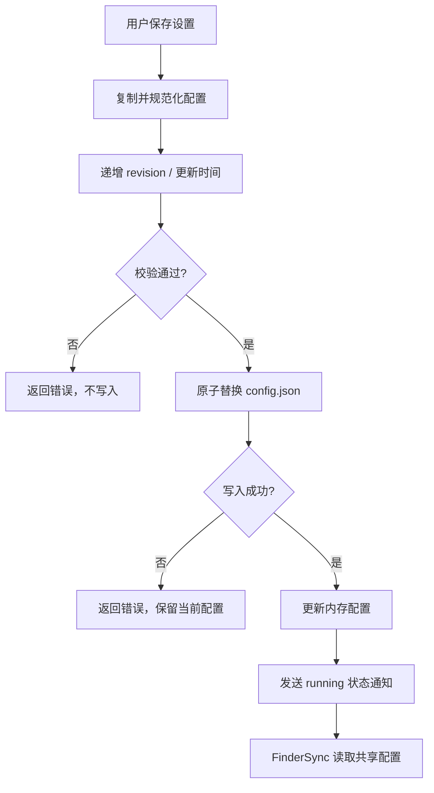
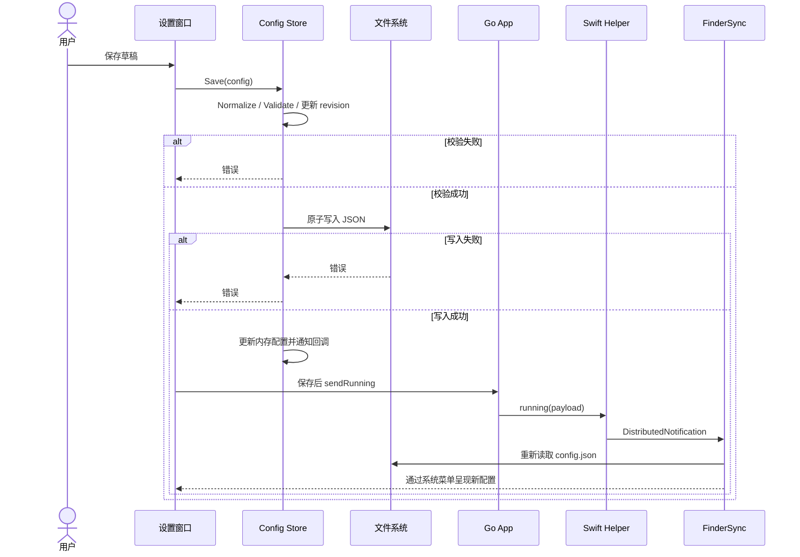
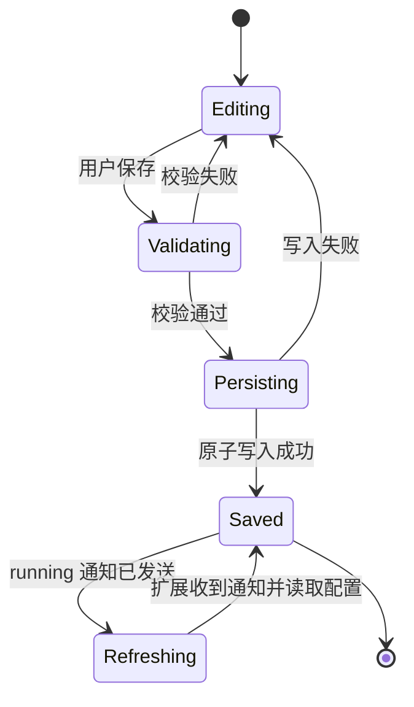

# 06 配置保存与扩展刷新（v1）

> 文档编号：06
> 文档版本：v1
> 项目：RClick
> 状态：主路径已实现；配置由两个进程共享
> 证据基线：当前工作区源码；无 Git commit 信息。

## 1. 流程目标

校验并原子保存设置后通知 FinderSync 刷新其配置视图。

## 2. 参与角色与前置条件

| 角色 | 职责 |
| --- | --- |
| 用户 / 设置窗口 | 编辑配置并点击保存 |
| Config Store | 规范化、校验、递增版本并原子写入 |
| Go 主程序 / helper | 保存成功后发送 `running` 通知 |
| FinderSync | 收到通知后重新读取共享 JSON |

## 3. 主流程图

## 4. 时序图

## 5. 状态机

通知发送失败时日志记录，不回滚已保存配置；此状态机不代表 Finder 的系统加载状态。

## 6. 关键异常与分支

| 场景 | 当前处理 |
| --- | --- |
| 校验失败 | 不写文件，返回错误 |
| 原子写入失败 | 不更新内存当前配置，返回错误 |
| 通知发送失败 | 记录日志；已保存配置不回滚 |
| 配置文件损坏 | 打开时保留损坏文件、Store 使用默认值并报告错误 |
| helper 不可用 | 设置仍可保存；无法通过 helper 触发扩展刷新 |

## 7. 证据索引

- [设置保存](../../internal/app/settings.go#L117-L135)
- [Store Open/Save/Reload](../../internal/config/store.go#L21-L97)
- [原子文件替换](../../internal/config/atomic.go#L9-L42)
- [保存后通知与授权目录](../../internal/app/app.go#L117-L145)
- [Finder 配置读取](../../native/finder/SharedConfigStore.swift#L170-L203)

## 8. 实现风险与待确认

- Go 与 Swift 共享 JSON 键；字段改名需同步验证双方解码。
- 通知已发送不等于扩展一定已加载或重绘菜单；需在 Finder 实机验证。
